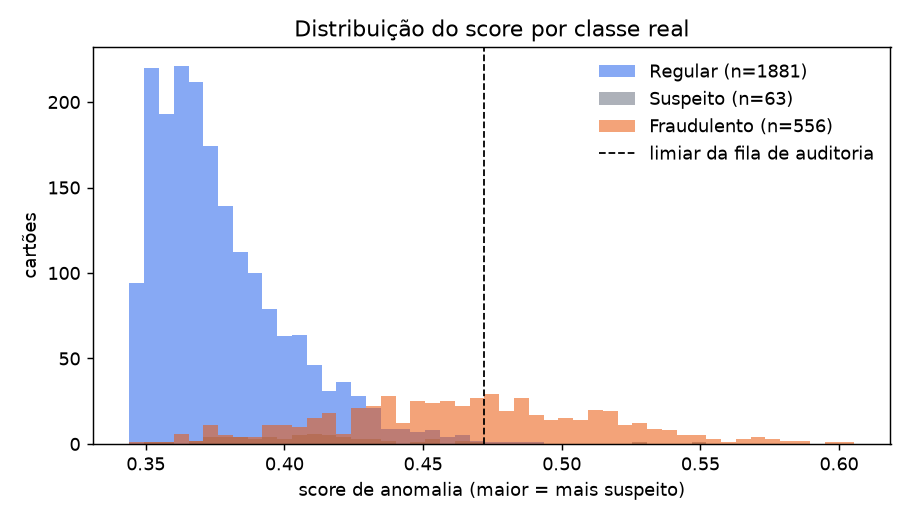
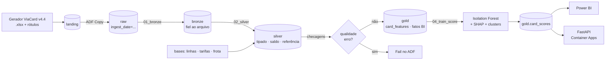
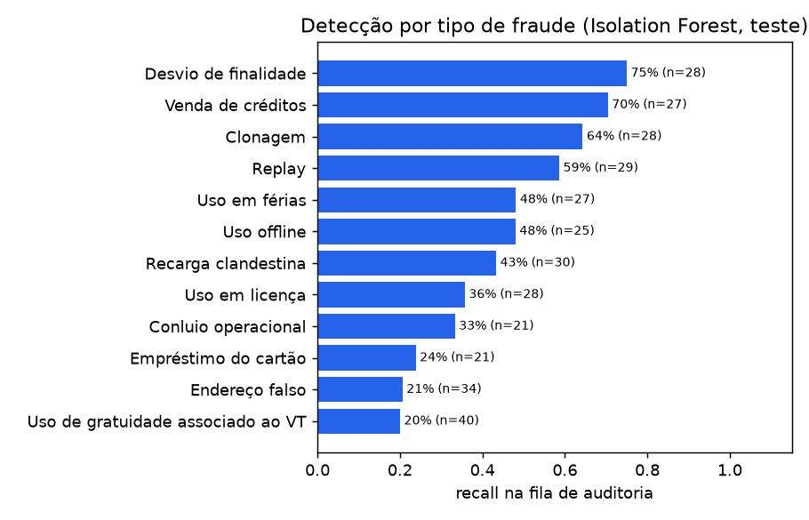

# Smart Ticket Fraud Detection

Detecção de fraude em **bilhetagem eletrônica de transporte público** (cartão ViaCard, corredor Sul
Fluminense – RJ), do extrato bruto do cartão até um score explicado servido por API.
Projeto de portfólio para **Engenharia de Dados**: pipeline medallion, qualidade de dados, Spark/Delta,
orquestração no Azure Data Factory, modelo de anomalia e deploy em container.

> **Stack:** Python · pandas · PySpark + Delta Lake (Databricks) · Azure Data Factory · ADLS Gen2 ·
> PostgreSQL · dbt (DuckDB local / Databricks SQL) · scikit-learn + SHAP · FastAPI · Docker ·
> Azure Container Apps · Bicep · GitHub Actions · Power BI

---

## Resultado em 30 segundos

| | |
|---|---|
| Dados | **2.500 cartões**, **7,77 milhões de transações** (≈5 anos cada), 24,8% de cartões com fraude rotulada |
| Pipeline local ponta a ponta | **8 min** (ingestão de 2.500 `.xlsx` em 3 min com leitura paralela) |
| Qualidade | **20/20** checagens aprovadas na silver (erro = pipeline para) |
| Modelo (Isolation Forest, sem rótulo) | **ROC-AUC 0,916 · PR-AUC 0,846** no teste |
| Fila de auditoria (top 10% dos cartões) | **precisão 97%**, lift 3,9× sobre o acaso |
| Features | **42** por cartão na gold (`card_features`); o modelo usa **36** delas (`mlops/model_config.yml`) — as 6 restantes são contagens/valores brutos usados só no BI |
| Testes | **35 pytest** (gerador, ingestão, lotes/quarentena, silver + qualidade, features, modelo, API, contrato de orquestração) + 1 paridade pandas × PySpark (roda no container Spark) · **17 testes dbt** (incl. paridade SQL × Python) |

Cada alerta vem com o **motivo** (SHAP). Exemplo real da fila:

```
#2 VINÍCIUS ALMEIDA ROCHA  (classe real: Fraudulento — Clonagem)
   troca de operadora em menos de 15 min (+1,53) · troca de linha no mesmo dia (+1,11)
   linhas diferentes: 27 (+0,97) · erros de leitura no validador (+0,68)
```



---

## Arquitetura

```
                 ┌──────────────────────┐
                 │      Azure ADF       │  Copy landing → raw (particionado por data)
                 │  Orquestração        │  + notebooks Databricks em sequência
                 └──────────┬───────────┘
                            │
                            ▼
                 ┌──────────────────────┐
                 │ Azure Databricks     │  PySpark: bronze → silver (qualidade) → gold
                 │ PySpark / ETL        │
                 └──────────┬───────────┘
                            │
                            ▼
                 ┌──────────────────────┐
                 │ Data Lake / Storage  │  ADLS Gen2 + Delta Lake (medallion)
                 └──────────┬───────────┘
                            │
                            ▼
                 ┌──────────────────────┐
                 │ ML Pipeline          │  Isolation Forest · SHAP · clusters
                 └──────────┬───────────┘      └─► gold/card_scores ─► Power BI
                            │
                            ▼
                 ┌──────────────────────┐
                 │ FastAPI              │  /score/transactions · /cards/{id}
                 │ Container Apps       │
                 └──────────────────────┘
```



O mesmo fluxo existe em dois ambientes, com o mesmo código de regra:

| Estágio | Local (pandas, `python -m src.pipeline`) | Azure (ADF → Databricks) |
|---|---|---|
| bronze | `src/data_pipeline/ingest.py` | `spark/01_bronze_ingest.py` (reusa o parser via `mapInPandas`) |
| silver | `src/data_pipeline/silver.py` + `quality.py` | `spark/02_silver_transform.py` (mesmo contrato de qualidade) |
| gold | `src/feature_engineering/` | `spark/03_gold_features.py` → `features_spark.py` (teste de paridade) |
| modelo | `src/training/train.py` | `spark/04_train_score.py` (chama o mesmo `train`) |

---

## Estrutura

```
smart-ticket-fraud-detection/
├── data/
│   ├── raw/                  extratos .xlsx gerados (não versionados)
│   ├── processed/            bronze / silver / gold (só gold/card_scores versionado)
│   └── synthetic/bases/      linhas, tarifas, frota DETRAN, 150 empregadoras
├── notebooks/
│   ├── 01_eda.ipynb
│   ├── 02_feature_engineering.ipynb
│   └── 03_modeling.ipynb
├── src/
│   ├── data_generator/       gerador ViaCard v4.4 (fraude materializada + rótulos por evento)
│   ├── data_pipeline/        ingest · silver · quality · reference · sql/ (Postgres) · spark/ (Databricks)
│   ├── feature_engineering/  42 features por cartão + tabelas do Power BI
│   ├── models/               Isolation Forest · avaliação · SHAP · clusters
│   ├── training/             treino, benchmarks, relatórios e figuras
│   ├── api/                  FastAPI
│   └── pipeline.py           orquestrador local (lê mlops/pipeline.yml)
├── dbt/                      staging → marts em SQL + 17 testes (DuckDB local / Databricks no Azure)
├── tests/
├── docker/
│   ├── Dockerfile            imagem da API
│   └── Dockerfile.spark      Spark 4 + Delta para validar os notebooks
├── mlops/
│   ├── pipeline.yml          estágios do pipeline (local e ADF)
│   ├── model_config.yml      features, hiperparâmetros, fila de auditoria
│   ├── adf/                  linked services, datasets, pipeline, trigger (formato Git do ADF)
│   ├── infra/                main.bicep + deploy.sh
│   ├── powerbi/              modelo semântico + medidas DAX
│   ├── artifacts/            model.joblib + model_card.json
│   └── reports/              metrics.md, recall por tipo, alertas explicados, figuras
├── .github/workflows/ci.yml
├── docker-compose.yml
├── requirements.txt          projeto + API + testes (.venv)
├── requirements-dbt.txt      dbt em ambiente separado (.venv-dbt): fixa outro pydantic
└── README.md
```

Fora do repositório, na pasta do Case: `04.2 - Dados Brutos - Lotes` (lotes 1–9), `04.3 - Bases de
Referência`, `04.4 - Extrato Modelo e Prompts do Gerador`, `04.5 - Power BI` (`.pbix` + projeto PBIP).

---

## Como rodar

Pré-requisitos: Python 3.14, Docker. Tudo a partir da raiz do repositório.

```bash
pip install -r requirements.txt
```

```bash
python -m src.data_generator.run --n 2500 --seed 0 --overwrite
```

```bash
python -m src.pipeline
```

```bash
pytest -q
```

dbt (ambiente próprio; o estágio `dbt_marts` do pipeline o encontra em `.venv-dbt`):

```bash
python -m venv .venv-dbt
```

```bash
.venv-dbt/Scripts/pip install -r requirements-dbt.txt
```

```bash
cd dbt && ../.venv-dbt/Scripts/python -m dbt.cli.main build --profiles-dir .
```

`python -m dbt.cli.main` faz o mesmo que `dbt` e continua funcionando se a pasta do projeto for movida
ou renomeada — o lançador `dbt.exe` do venv guarda o caminho absoluto antigo e quebra.

Spark local (Windows): use o container (`docker compose --profile spark …`). O Spark nativo no Windows
exige `winutils.exe`/`hadoop.dll`, que a Apache não distribui, e o `.cmd` de inicialização falha em
caminhos com parênteses.

API (imagem com modelo e scores embutidos):

```bash
docker compose up -d --build api
```

```bash
curl localhost:8000/cards/42.973302951-4
```

Fundamentos de SQL (carrega silver/gold no Postgres e grava `src/data_pipeline/sql/03_respostas.md`):

```bash
docker compose up -d postgres
```

```bash
python -m src.data_pipeline.sql.load_postgres
```

Notebooks Databricks + paridade pandas × PySpark, num Spark 4 local:

```bash
docker compose --profile spark run --rm -e RAW_PATH=/workspace/data/raw/amostra_40 spark
```

```bash
docker compose --profile spark run --rm spark pytest -q tests/test_spark_parity.py
```

O comando padrão roda os notebooks 01–03. Para incluir o `04_train_score` e o registro no catálogo,
instale no container as bibliotecas que o ADF instala na atividade `TreinoScore` (validado em 02/11/2026
na amostra: 40 arquivos, 122.961 transações, silver 15/15, 42 features, 4 alertas):

```bash
docker compose --profile spark run --rm -e RAW_PATH=/workspace/data/raw/amostra_40 -e LAKE_ROOT=/workspace/data/processed/lakehouse_amostra -e CATALOG=spark_catalog spark bash -lc 'pip install -q scikit-learn==1.9.1 shap==0.52.0 tabulate==0.10.0 matplotlib joblib && for nb in 01_bronze_ingest 02_silver_transform 03_gold_features 04_train_score; do python src/data_pipeline/spark/$nb.py || exit 1; done'
```

No **Git Bash**, rode antes `export MSYS_NO_PATHCONV=1`: sem isso o Git Bash converte `/workspace/...` em um
caminho do Windows (`C:/Program Files/Git/workspace/...`) e o Spark falha com
`No FileSystem for scheme "C"`. No PowerShell não é preciso.

Deploy no Azure (depois de `az login` e `databricks auth login`): [`mlops/infra/deploy.sh`](mlops/infra/deploy.sh).

Power BI: `python -m src.data_pipeline.export_bi` grava em `data/processed/powerbi` a gold do
`viacard_v44` (2.500 cartões, fila de 250), que é o que o relatório *Fila de Auditoria* lê — passo a passo no
[**guia do Power BI**](mlops/powerbi/README.md). As gerações antigas de extratos (lotes 1 a 9, 13,8 mil
cartões) servem só de prova negativa e de comparação: veja o [**Manual dos lotes**](MANUAL_LOTES.md).

---

## Os dados: por que o gerador teve de mudar

O gerador sintético ViaCard (v4.3) produzia extratos muito realistas — dupla carteira, fila FIFO de
recargas, bloqueio de 18 meses, frota e tarifas reais — **mas a fraude era só uma marca interna**:
o extrato de um fraudador era idêntico ao de um usuário regular. Nenhum modelo aprenderia, e nenhuma
métrica seria honesta.

A **v4.4** ([`src/data_generator/viacard/fraudes.py`](src/data_generator/viacard/fraudes.py)) materializa
cada tipo como **episódios** plausíveis, sempre ≤ 15% das utilizações, com rótulo por evento
(`rotulos_eventos.csv`) que nunca aparece no `.xlsx`:

| Fraude | O que muda no extrato |
|---|---|
| Venda de créditos | 2–4 embarques extras/dia em outra linha, horário comercial |
| Empréstimo do cartão | ida/volta em dia de folga, em outra linha |
| Endereço falso | recargas dimensionadas para tarifa declarada 1,5–2,2× maior |
| Uso em férias | 15–30 dias sem rotina, com viagens intermunicipais |
| Uso em licença | 2–5 meses sem rotina, embarques esporádicos no meio do dia |
| Desvio de finalidade | viagens noturnas / de fim de semana em outra linha |
| Clonagem | embarque em outra operadora minutos após o legítimo (+ erro de leitura) |
| Replay | mesma transação (linha, carro, sentido) repetida segundos depois |
| Recarga clandestina | crédito sem pedido da empregadora, valor redondo, fora da dupla passada |
| Uso offline | embarque NORMAL registrado sem débito no saldo |
| Conluio operacional | tarifa abaixo da tabela, sempre no mesmo carro |
| Gratuidade + VT | rotina some; outra pessoa usa o VT em outra linha no mesmo dia |

Para a detecção não ficar trivial, a v4.4 também adiciona **hábitos legítimos parecidos com fraude**
(passeios em folgas para 45% dos passageiros, viagens intermunicipais eventuais). O auditor V1–V15 do
gerador continua valendo para o comportamento legítimo, e a nova validação VF garante o limite de 15%.
Os 2.500 extratos passaram em todas as validações.

**A prova empírica.** Rodar o mesmo pipeline sobre as gerações antigas (lotes 1 a 9: 13.028 cartões,
43,2 M de transações — veja o [Manual dos lotes](MANUAL_LOTES.md)) dá **ROC-AUC 0,503**, e o modelo
supervisionado, que enxerga os rótulos, não passa de 0,536. O sinal não existia nos dados; com a v4.4,
o mesmo código chega a 0,916.

---

## Pipeline medallion

**Bronze** — fiel ao arquivo: `transactions`, `admin_pendentes`, `files`, rótulos. Leitura com
`python-calamine` (~40 ms/arquivo, 75× mais rápido que openpyxl) em processos paralelos; arquivo
corrompido vira linha em `files.erro`, não derruba o lote.

**Silver** — onde a engenharia vira sinal:
- ordem cronológica respeitando a **dupla passada** (recarga entra antes do embarque no mesmo instante);
- parsing da descrição `OPERADOR CARRO LINHA SENTIDO` (o pipeline antigo lia o carro como "linha" — corrigido);
- **continuidade do saldo** `saldo(n) = saldo(n-1) + crédito − débito`: quebra = validador offline;
- enriquecimento com as bases oficiais: tipo de linha, **tarifa de tabela** (conluio), veículo na frota;
- 20 checagens de qualidade (domínio, nulos, teto de R$ 1.500, cronologia, duplicatas, parsing 100%,
  referência) com severidade: `erro` bloqueia, `alerta` registra ([`quality_report.json`](src/data_pipeline/quality.py)).

**Gold** — `card_features` (1 linha por cartão, 42 features) e fatos para o Power BI
(`fato_embarques_diario`, `fato_embarques_mensal` — o que o relatório consome —, `fato_recargas_mensal`).

---

## Features

A unidade de fraude é o **portador**, não a viagem — e isso dá split por entidade de graça.
Nenhuma feature usa rótulo. Os grupos seguem as hipóteses de fraude:

| Hipótese | Exemplos |
|---|---|
| Uso por terceiros | `pct_linha_principal`, `n_linhas`, `pct_troca_linha_mesmo_dia` |
| Replay / clonagem | `pct_replay`, `pct_reembarque_5min`, `pct_troca_operadora_15min`, `pct_erro_leitura` |
| Validador offline | `pct_inconsistencia_saldo` |
| Conluio | `pct_tarifa_divergente`, `pct_veiculo_mais_usado` |
| Recarga clandestina | `pct_recarga_valor_redondo`, `pct_recarga_sem_dupla_passada` |
| Desvio / licença / férias | `pct_noite`, `pct_meio_dia`, `pct_intermunicipal`, `maior_sequencia_dias` |
| **Episódios** | `pico_mensal_*`: o pior mês do cartão contra o próprio histórico |

Os picos mensais foram a decisão que mais pesou: fraude acontece em janelas de semanas, e a média de
cinco anos dilui o sinal. Detalhes e poder de separação de cada feature em
[`02_feature_engineering.ipynb`](notebooks/02_feature_engineering.ipynb).

---

## Modelo e avaliação

Split **estratificado por cartão** (70/30). Produção: **Isolation Forest** (não supervisionado — em
operação real quase não há fraude confirmada). Benchmarks no mesmo teste:

| Modelo | ROC-AUC | PR-AUC | Precisão@10% | Recall@10% |
|---|---|---|---|---|
| **Isolation Forest (produção)** | **0,916** | **0,846** | **0,973** | 0,393 |
| LOF | 0,804 | 0,638 | 0,827 | 0,333 |
| Gradient Boosting supervisionado (teto de sinal) | 0,974 | 0,964 | 1,000 | 0,403 |

Com uma fila do tamanho da prevalência (25% dos cartões), o Isolation Forest acerta **75%** e captura
75% das fraudes; o teto supervisionado chega a 90%.



**Leitura honesta dos limites:**
- Tipos com assinatura operacional forte (desvio, venda, clonagem, replay) são bem capturados; os que
  **imitam comportamento legítimo** (gratuidade + VT, endereço falso, empréstimo) ficam em 20–24%.
- **Suspeitos** (intensidade de fraude muito baixa por construção) não entram na fila de 10%.
- Os dados são sintéticos e as features foram desenhadas conhecendo as hipóteses do gerador: os números
  são **otimistas** frente a dados reais. O valor do case está no método (rótulo fora das features,
  split por entidade, benchmark de teto, recall por tipo), não no número absoluto.
- A distância entre o IF e o teto supervisionado é o argumento de produto: usar o resultado da
  auditoria como rótulo e evoluir para um modelo semi-supervisionado.

Explicabilidade: SHAP (TreeExplainer) sobre o Isolation Forest, com motivos em português por cartão
([`alertas_explicados.csv`](mlops/reports/alertas_explicados.csv)). Perfis: KMeans (k=4 por silhouette) —
um dos clusters concentra 100% de fraude (uso espalhado em ~10 linhas) e o maior (1.538 cartões,
rotina numa linha só) tem 12%.

---

## API

| Método | Rota | Uso |
|---|---|---|
| GET | `/health` | liveness/readiness do Container Apps |
| GET | `/model` | model card (versão, features, limiar, métricas) |
| GET | `/cards/{card_id}` | score da última execução do pipeline |
| POST | `/score/features` | pontua um vetor de features |
| POST | `/score/transactions` | recebe as validações de um cartão, aplica **o mesmo código** da silver/gold e devolve score + motivos |

Documentação interativa em `localhost:8000/docs`.

---

## Nuvem (Azure)

- **ADF** ([`mlops/adf`](mlops/adf)): Copy landing → raw particionado por data, notebooks Bronze → Silver
  → Gold → TreinoScore em job cluster efêmero, atividade `Fail` com código `DQ_SILVER` quando a qualidade
  bloqueia, trigger diário às 02:00.
- **Databricks** ([`src/data_pipeline/spark`](src/data_pipeline/spark)): notebooks em formato fonte
  (versionáveis), Delta por caminho registrado como tabela externa no Unity Catalog (`smart_ticket.<camada>.<tabela>`, widget `catalog`), `OPTIMIZE ZORDER BY card_id`. Validados
  localmente em Spark 4 + Delta 4 no container `docker/Dockerfile.spark`.
- **Infra** ([`mlops/infra/main.bicep`](mlops/infra/main.bicep)): ADLS Gen2 sem chave compartilhada,
  ADF e Databricks com identidade gerenciada + RBAC, ACR, Container Apps escalando a zero.
  O `deploy.sh` (7 passos) também prepara o Unity Catalog: credencial do access connector, locais externos,
  catálogo/schemas, permissões da MSI do ADF e a política de cluster `stf-uc-jobs`.
- **CI** ([`.github/workflows/ci.yml`](.github/workflows/ci.yml)): testes → build + smoke test da imagem →
  deploy no ACR/Container Apps via OIDC (liga com a variável `AZURE_DEPLOY=true`).
- **Power BI** ([`mlops/powerbi`](mlops/powerbi)): esquema estrela sobre a gold e medidas DAX (operação,
  fila de auditoria, perfis, qualidade do modelo).

---

## Status do cronograma

| Etapa | Status |
|---|---|
| Fund. — SQL | ✅ esquema Postgres + 11 perguntas de negócio com CTEs e window functions (LAG/LEAD, NTILE, gaps and islands, média móvel) — [`sql/`](src/data_pipeline/sql) |
| Fund. — Docker | ✅ API + Postgres + Spark em containers |
| Fund. — Cloud | 🟡 código pronto (Bicep, ADF, notebooks); falta executar na conta Azure |
| Fund. — Git | ✅ repositório com commits por etapa (falta publicar no GitHub) |
| Sprint 1 — MVP | ✅ reprodutível do gerador ao score |
| Sprint 2 — Pipeline | ✅ medallion local + Databricks/ADF · ✅ dbt (11 modelos, 17 testes, paridade com a gold; alvo `azure` = Databricks SQL) |
| Sprint 3 — Qualidade/prova | ✅ checagens bloqueantes, pytest, métricas com rótulo, SHAP, clusters · ✅ `Fila de Auditoria.pbix` + projeto PBIP (4 páginas, 24 medidas) · 🟡 publicar no Power BI Service |
| Sprint 4 — Deploy | ✅ API em Docker, CI, IaC · 🟡 publicação no Container Apps pendente de login |

---

## Diário de decisões

- **Consertar o gerador antes do modelo.** A v4.3 não deixava rastro de fraude; medir um modelo sobre ela
  seria medir ruído. Materializar a fraude com rótulo por evento foi pré-requisito de qualquer métrica.
- **Rótulo fora das features, sempre.** Os rótulos vivem em tabelas próprias (`labels_*`) e só entram na
  avaliação — evita a circularidade de medir o modelo com a regra que o gerou.
- **Isolation Forest em produção, supervisionado só como teto.** Em operação não há rótulo confiável; o
  benchmark supervisionado mostra quanto sinal ainda falta capturar.
- **Fila de auditoria como métrica de negócio.** Precisão@k é retrabalho do time; recall@k é fraude pega.
- **ADF e não Airflow.** Stack Azure pedida nas vagas, conectores nativos para ADLS/Databricks, sem
  servidor para manter. O `pipeline.yml` + `src/pipeline.py` preservam a lógica de DAG transferível para Airflow.
- **Mesmo código de regra no local, no Databricks e na API.** Parser reusado no Spark, contrato de
  qualidade único, features com teste de paridade e a API chamando a própria silver/gold.
- **Qualidade com severidade.** Dado quebrado não chega à gold; alerta não para a operação.
- **Calamine em vez de openpyxl** na leitura, e NamedStyles na escrita do gerador: 75× e 4× mais rápidos.
- **Picos mensais contra o próprio histórico** em vez de médias longas — fraude é episódica.

---

## Narrativa de 2 minutos

> Bilhetagem eletrônica gera milhões de validações, e o vale-transporte é desviado de formas que o
> sistema não bloqueia: venda de créditos, cartão emprestado, clonagem, conluio com motorista. Construí um
> pipeline que parte do extrato bruto de cada cartão e entrega uma fila de auditoria explicada.
>
> O primeiro achado foi nos próprios dados: o gerador sintético marcava fraude sem deixar rastro no
> extrato, então evoluí o gerador para materializar doze tipos de fraude plausíveis, com rótulo por evento.
>
> Na engenharia, montei um medallion: bronze fiel ao arquivo, silver que reconstrói a ordem da dupla passada
> e a continuidade do saldo — que é o que denuncia validador offline — com checagens de qualidade que param o
> pipeline, e uma gold com uma linha por cartão. O mesmo código roda local, em notebooks Databricks
> orquestrados pelo Data Factory, e dentro da API.
>
> O modelo é um Isolation Forest, sem rótulo, como seria em produção: ROC-AUC de 0,92 e 97% de precisão na
> fila dos 10% mais suspeitos, com o motivo de cada alerta via SHAP. E eu mostro onde ele falha — fraudes
> que imitam uso legítimo — e por que o próximo passo é usar o resultado da auditoria como rótulo.
