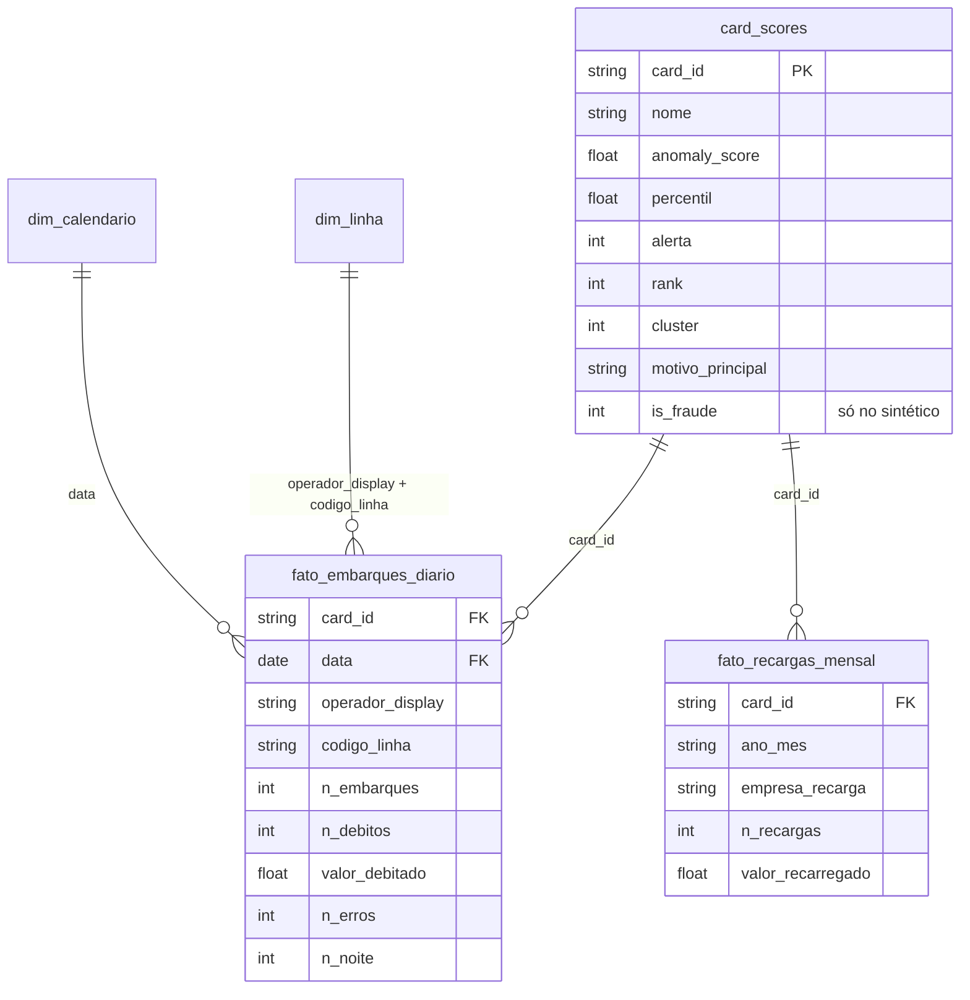

# Power BI — modelo semântico sobre a camada ouro

O dashboard lê **apenas a gold**: nada de regra de negócio no Power BI, só medidas.

## Conexão

| Ambiente | Como conectar |
|---|---|
| Azure | *Obter dados → Azure Databricks* → Server hostname / HTTP path do SQL Warehouse → tabelas Delta `gold.*` em **DirectQuery** para `card_scores` e **Import** (atualização diária) para as fatos. |
| Local | *Obter dados → Parquet* apontando para `data/processed/gold/*.parquet` (gerados por `python -m src.pipeline`). |

## Esquema estrela

- `dim_linha`: criar a coluna `linha_key = operador_display & "|" & codigo_linha` na dimensão e na fato e relacionar por ela.
- `dim_calendario`: `CALENDAR(DATE(2020,1,1), DATE(2025,12,31))` marcada como tabela de datas.
- Medidas em [`medidas.dax`](medidas.dax).

## Páginas

1. **Operação** — Embarques, Receita, Ticket Médio, Cartões Ativos; série mensal com MoM e média móvel; mapa de calor hora × dia da semana; top linhas.
2. **Fila de auditoria** — cartões em alerta ordenados por `rank`, com `motivo_principal` (SHAP) e drill-through para o histórico diário do cartão.
3. **Perfis** — clusters (tamanho, score médio, % em alerta) e distribuição do score.
4. **Qualidade do modelo** *(só sintético)* — Precisão/Recall da fila, taxa de fraude por decil de score.

O arquivo `.pbix` não é versionado (binário); este README e `medidas.dax` são a fonte da verdade do modelo.
