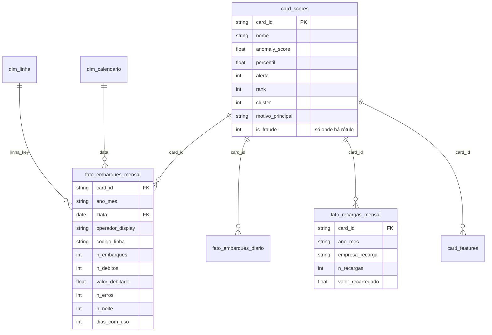

# Power BI — do zero ao dashboard

O dashboard lê **apenas a camada gold**: nada de regra de negócio no Power BI, só medidas.
Este guia cobre a conexão local (arquivos gerados pelo pipeline) e a conexão na nuvem (Databricks).

---

## 1. Escolha a fonte

| Cenário | Fonte | Quando usar |
|---|---|---|
| **Local (padrão)** | Parquet em `data/processed/.../gold` | seu caso: pipeline rodou na máquina |
| Nuvem | Azure Databricks (SQL Warehouse) | depois do deploy: tabelas Delta `gold.*` |
| Alternativa | PostgreSQL | quando o time já consome o Postgres do projeto |

Para o caso local, gere a pasta de consumo (o fato diário fica grande; corte o período):

```bash
python -m src.data_pipeline.export_bi --gold data/processed/lotes/consolidado/gold --out data/processed/powerbi --desde 2023-01-01
```

Saem em `data/processed/powerbi`: `card_scores`, `card_features`, `fato_embarques_mensal`,
`fato_embarques_diario`, `fato_recargas_mensal` e `dim_linha`. Use `--formato csv` se precisar de CSV.

---

## 2. Conectar (Power BI Desktop)

**Arquivo único (parquet):** *Página Inicial → Obter dados → Mais… → Arquivo → Parquet →
Conectar* e aponte, por exemplo, `data\processed\powerbi\fato_embarques_mensal.parquet`.
Repita para `card_scores`, `card_features`, `fato_recargas_mensal` e `dim_linha`.

**Parâmetro de caminho.** O modelo PBIP (`04.5.2 - Projeto PBIP`) usa o parâmetro Power Query
`PastaRepositorio` (Página Inicial → Transformar dados → Editar parâmetros). Aponte-o para a raiz do
repositório, terminando em `\`, e todas as tabelas passam a ler dali — mover a pasta não quebra o relatório.

**Pasta particionada por lote** (se preferir ler direto de `consolidado/gold/fato_embarques_diario`,
que tem um arquivo por lote): *Obter dados → Mais… → Arquivo → Pasta*, depois *Transformar dados →
Editor Avançado* e cole:

```m
let
    Origem     = Folder.Files(PastaRepositorio & "data\processed\lotes\consolidado\gold\fato_embarques_diario"),
    SoParquet  = Table.SelectRows(Origem, each Text.EndsWith([Name], ".parquet")),
    Lidos      = Table.AddColumn(SoParquet, "Dados", each Parquet.Document([Content])),
    Somente    = Table.SelectColumns(Lidos, {"Dados"}),
    Expandido  = Table.ExpandTableColumn(Somente, "Dados",
                   {"card_id", "data", "operador_display", "codigo_linha", "tipo_linha",
                    "n_embarques", "n_debitos", "valor_debitado", "n_erros", "n_noite"}),
    Tipado     = Table.TransformColumnTypes(Expandido,
                   {{"data", type date}, {"valor_debitado", type number}, {"n_embarques", Int64.Type}})
in
    Tipado
```

**No fato mensal**, crie a data que vai se relacionar com o calendário — *Adicionar Coluna →
Coluna Personalizada*, nome `Data`:

```m
Date.FromText([ano_mes] & "-01")
```

**Na nuvem:** *Obter dados → Azure Databricks*, informe **Server hostname** e **HTTP path** do SQL
Warehouse, escolha as tabelas `gold.*`. Use **DirectQuery** para `card_scores` (fila de auditoria sempre
fresca) e **Import** para os fatos, com atualização diária após o pipeline do Data Factory.

---

## 3. Tabela de calendário

*Modelagem → Nova tabela*:

```dax
dim_calendario =
ADDCOLUMNS (
    CALENDAR ( DATE ( 2020, 1, 1 ), DATE ( 2025, 12, 31 ) ),
    "Ano", YEAR ( [Date] ),
    "NumeroMes", MONTH ( [Date] ),
    "Mes", FORMAT ( [Date], "MMM" ),
    "AnoMes", FORMAT ( [Date], "YYYY-MM" ),
    "DiaSemana", FORMAT ( [Date], "ddd" ),
    "FimDeSemana", WEEKDAY ( [Date], 2 ) > 5
)
```

Selecione a tabela → *Ferramentas de Tabela → Marcar como tabela de data* → coluna `Date`.

Crie também a chave de linha nas duas pontas (*Nova coluna*), porque a linha só é única com a operadora:

```dax
linha_key = dim_linha[operador_display] & "|" & dim_linha[codigo_linha]
```

```dax
linha_key = fato_embarques_mensal[operador_display] & "|" & fato_embarques_mensal[codigo_linha]
```

---

## 4. Relacionamentos

Em *Exibição de Modelo*, arraste para criar (todos **um para muitos**, filtro **único**):

| De (1) | Para (muitos) |
|---|---|
| `card_scores[card_id]` | `fato_embarques_mensal[card_id]` |
| `card_scores[card_id]` | `fato_embarques_diario[card_id]` |
| `card_scores[card_id]` | `fato_recargas_mensal[card_id]` |
| `card_scores[card_id]` | `card_features[card_id]` |
| `dim_calendario[Date]` | `fato_embarques_mensal[Data]` |
| `dim_calendario[Date]` | `fato_embarques_diario[data]` |
| `dim_linha[linha_key]` | `fato_embarques_mensal[linha_key]` |

Oculte as colunas de chave (`card_id`, `linha_key`) para deixar o painel de campos limpo.



---

## 5. Medidas

Copie cada medida de [`medidas.dax`](medidas.dax) em *Modelagem → Nova medida* (uma por vez).
Elas cobrem operação (Embarques, Receita, Ticket Médio, Cartões Ativos, MoM, média móvel),
fila de auditoria (Cartões em Alerta, % em Alerta, Receita em Alerta) e, onde há rótulo,
qualidade do modelo (Precisão e Recall da Fila).

Se você conectou o fato mensal, troque `fato_embarques_diario` por `fato_embarques_mensal`
nas medidas de soma — os nomes das colunas são os mesmos. Ou use direto
[`medidas_mensal.dax`](medidas_mensal.dax): é a versão sobre o fato mensal, com as 24 medidas do relatório
pronto (`Fila de Auditoria.pbix`, na pasta `04.5 - Power BI` do Case).

**Páginas por código (opcional).** [`gerar_relatorio_pbir.py`](gerar_relatorio_pbir.py) escreve as quatro
páginas (Operação, Fila de auditoria, Perfis, Qualidade do modelo) no formato PBIR, dentro da pasta
`.Report` de um projeto PBIP — é assim que o `04.5.2 - Projeto PBIP (código-fonte)` foi montado:

```bash
python mlops/powerbi/gerar_relatorio_pbir.py "<pasta>/Fila de Auditoria.Report" "<tema>/Fluent2-CY26SU08.json"
```

---

## 6. Páginas sugeridas

1. **Operação** — cartões com Embarques, Receita, Ticket Médio e Cartões Ativos; linha do tempo mensal com
   MoM; matriz hora × dia da semana (use o fato diário); top 10 linhas por embarques.
2. **Fila de auditoria** — tabela ordenada por `rank` com `nome`, `anomaly_score`, `percentil` e
   `motivo_principal`; segmentação por `alerta`; *drill-through* para o histórico diário do cartão.
3. **Perfis** — dispersão de clusters (tamanho = cartões, cor = cluster), com % em alerta por cluster.
4. **Qualidade do modelo** *(só onde há rótulo)* — Precisão e Recall da Fila, e taxa de fraude por decil
   de `anomaly_score` (crie a coluna de decil no Power Query ou use a consulta `q10` do Postgres).

---

## 7. Atualizar depois de rodar o pipeline

1. `python -m src.pipeline` (ou `src.data_pipeline.lotes` para os lotes antigos);
2. `python -m src.data_pipeline.export_bi …` para regravar os arquivos;
3. no Power BI Desktop: *Página Inicial → Atualizar*.

Como os caminhos não mudam, a atualização não pede nenhuma reconfiguração.

---

## 8. Desempenho

- O **fato mensal** é o padrão do modelo: ~1 linha por cartão, mês e linha. O **diário** só entra quando a
  análise exigir hora ou dia — filtre o período com `--desde`.
- Prefira **Parquet a CSV**: menor, tipado e muito mais rápido para carregar.
- Nada de colunas calculadas pesadas no Power BI: se precisar de um campo novo em milhões de linhas,
  calcule na gold (`src/feature_engineering/build.py`) e reexporte.
- O `.pbix` não é versionado (binário); fica em `04.5 - Power BI` do Case, junto do projeto PBIP (texto).
  Este guia, `medidas.dax` e `medidas_mensal.dax` são a fonte da verdade do modelo.
